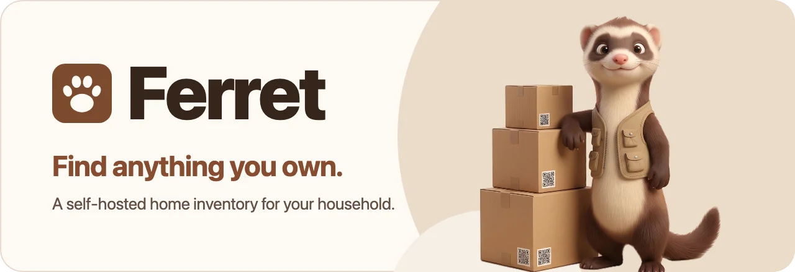
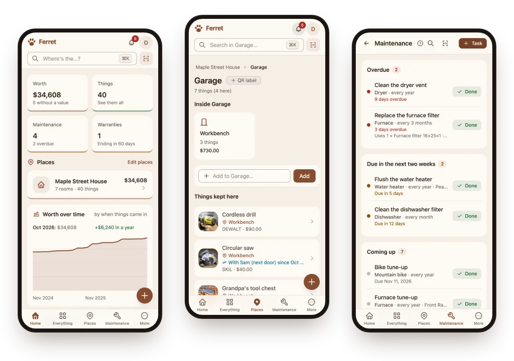

<picture>
  <source media="(prefers-color-scheme: dark)" srcset=".github/readme/banner-dark.webp">
  
</picture>

<p align="center">
  <a href="https://github.com/ferret-project/ferret/releases/latest"></a>
  <a href="LICENSE"></a>
  <a href="https://hub.docker.com/r/ferretproject/ferret"></a>
  <a href="https://discord.gg/XSkKyP2pdg"></a>
  <a href="https://glama.ai/mcp/servers/ferret-project/ferret"></a>
</p>

<p align="center">
  <a href="https://ferret-demo.digitalempire.us"><b>Try the demo</b></a> ·
  <a href="#run-it-docker"><b>Install</b></a> ·
  <a href="https://ferret-demo.digitalempire.us/docs/"><b>Help</b></a> ·
  <a href="https://discord.gg/XSkKyP2pdg"><b>Discord</b></a>
</p>

**Ferret is a home inventory you run yourself.** Your household's properties, rooms and boxes; the things in them with
photos, receipts and manuals; warranties, maintenance and stock — all on your own server, shared with the people you
live with. And when you need something, Ferret tells you where it is.

<picture>
  <source media="(prefers-color-scheme: dark)" srcset=".github/readme/screens-dark.webp">
  
</picture>

## What it does

Add things fast, label boxes, find anything, keep receipts and warranties, schedule maintenance, track stock and
the shopping list, remember what you lent, and print an insurance report. Claude can do all of it too, over MCP.

<table>
  <tr>
    <td align="center" width="33%">
      <br>
      <b>Add things fast</b><br>
      Snap a photo, scan a barcode, or photograph a whole room and pick what to keep.
    </td>
    <td align="center" width="33%">
      <br>
      <b>Boxes and QR labels</b><br>
      Print labels for boxes and shelves; scan one to see what's inside.
    </td>
    <td align="center" width="33%">
      <br>
      <b>Find anything</b><br>
      Search by name, place or meaning — or just ask, “where's the drill?”
    </td>
  </tr>
  <tr>
    <td align="center">
      <br>
      <b>Receipts and warranties</b><br>
      Keep receipts and manuals with each thing, and hear before a warranty or a return window runs out.
    </td>
    <td align="center">
      <br>
      <b>Maintenance</b><br>
      Filters, tune-ups and checks on a schedule, with reminders when they're due, and how-to videos for each job and each thing.
    </td>
    <td align="center">
      <br>
      <b>Stock and shopping</b><br>
      Track what runs out and keep the shopping list in step.
    </td>
  </tr>
  <tr>
    <td align="center">
      <br>
      <b>Lending</b><br>
      Remember who borrowed the saw, and since when.
    </td>
    <td align="center">
      <br>
      <b>Insurance report</b><br>
      Everything you own and what it's worth, ready for a claim, plus recall checks.
    </td>
    <td align="center">
      <br>
      <b>API and MCP</b><br>
      A REST API for scripts, and an MCP server so Claude can look things up and add them.
    </td>
  </tr>
</table>

## Why Ferret

- **Your server, your data.** One Docker container with SQLite. Uploads are encrypted at rest with a key per
  household; nightly backups with a restore check; *Download everything* any time.
- **Households, not just accounts.** Owners, admins, members and read-only viewers; invitations by email; single
  sign-on through your own identity provider.
- **AI is optional.** Point it at your own models (Ollama, any OpenAI-compatible server, docling) for suggestions from
  photos, receipts read for you, *Ask Ferret* and search by meaning. Nothing is applied without a tap.
- **Made for the phone.** An installable app that works offline, with barcode and QR scanning built in.

## Run it (Docker)

```bash
curl -O https://raw.githubusercontent.com/ferret-project/ferret/main/compose.yaml
curl -o .env https://raw.githubusercontent.com/ferret-project/ferret/main/.env.example
# In .env: AUTH_SECRET and FILES_KEY (each: openssl rand -base64 32), and PUBLIC_URL
docker compose up -d
```

The image is on [GitHub's registry](https://github.com/ferret-project/ferret/pkgs/container/ferret)
(`ghcr.io/ferret-project/ferret`) and [Docker Hub](https://hub.docker.com/r/ferretproject/ferret)
(`ferretproject/ferret`) — the same tags on both (`latest`, or a release like `2026.11.2`), for x86-64 and 64-bit ARM.

Then open `PUBLIC_URL`; the first account made is the server admin. Keep a copy of `FILES_KEY` somewhere safe —
without it, uploaded files can't be read. Behind a reverse proxy, set `TRUSTED_PROXIES` to its address.

The help is built in at `/docs`: [installing](https://ferret-demo.digitalempire.us/docs/hosting/install),
[every setting](https://ferret-demo.digitalempire.us/docs/hosting/configuration),
[AI](https://ferret-demo.digitalempire.us/docs/hosting/ai), [backups](https://ferret-demo.digitalempire.us/docs/hosting/backups)
and [connecting Claude](https://ferret-demo.digitalempire.us/docs/guide/claude).

## Use it with Claude (MCP)

Ferret has an MCP server built in at `/mcp`, so Claude (or any MCP client) can use your inventory for you:

- *"Where did we put the tent?"*
- *"Add the new blender — it was $89 at Target, it's in the kitchen."*
- *"We used the last furnace filter."* (stock goes down, and it's on the shopping list)
- *"What maintenance is due this month, and when does the dishwasher warranty end?"*

Make a key in Ferret (**Household & settings → Claude & API → New key**), then:

```bash
claude mcp add --transport http ferret https://ferret.example.com/mcp --header "Authorization: Bearer ferret_…"
```

Other clients that speak Streamable HTTP take the same address and header (`X-API-Key: ferret_…` works too):

```json
{
  "mcpServers": {
    "ferret": {
      "type": "http",
      "url": "https://ferret.example.com/mcp",
      "headers": { "Authorization": "Bearer ferret_…" }
    }
  }
}
```

Clients that only start a local program and talk to it over stdio (Docker's MCP Toolkit, desktop apps' config files)
can use the small bridge in [`contrib/mcp-bridge`](contrib/mcp-bridge): it forwards each message to your Ferret with the
key. Ferret is also listed in the [MCP Registry](https://registry.modelcontextprotocol.io) as
`io.github.ferret-project/ferret`.

**What Claude can do** (55 tools):

| | |
|---|---|
| Find | search by words and meaning, ask questions answered from receipts and manuals, items, places, history, files, recently deleted; look at an item's photos |
| Add and change | add items (also from a photo, or a whole room's photos), update, move and restore, change many at once; properties, rooms, categories and collections; QR labels; sort the Paperless-ngx inbox |
| Upkeep | maintenance by date or by use (odometer, engine hours), repairs, warranties and claims, recalls, replacement forecast, service providers |
| Household | stock and the shopping list, lending, barcodes, collections, room reviews and last seen, the insurance report and coverage limits, what needs attention |

<a href="https://glama.ai/mcp/servers/ferret-project/ferret"></a>

**Safe by design.** A key acts for one person in one household, can be **read-only** (Claude can look and ask, but the
tools that change things aren't offered) and can expire; revoke it any time. Viewers' keys are always read-only.
Removing anything goes through one tool, marked destructive, so a client can ask before each one. Deleted things wait 30 days in *Recently deleted*, and nothing a model suggests from a photo or document is applied
until someone confirms it.

## Develop

Requirements: Node 26+, pnpm 10 (`npm install -g corepack && corepack enable`).

```bash
cp .env.example .env      # AUTH_SECRET and FILES_KEY, as above
pnpm install
pnpm dev                  # server on :8787, web app on :5173
pnpm test
pnpm typecheck
```

| Path | What |
|---|---|
| `apps/server` | Hono API, Better Auth, Drizzle + SQLite; MCP server; adapters behind ports (`src/ports.ts`) |
| `apps/web` | React 19 + Vite + Tailwind v4 + FlyonUI PWA |
| `apps/docs` | The help (VitePress), served at `/docs` |
| `packages/shared` | Zod schemas and helpers shared by the server and the web app |

## Translations

Ferret is written in English, and English is the only language kept up in this repository. Other languages are made
by the people who use Ferret, on [Weblate](https://hosted.weblate.org/projects/ferret/) and in
[ferret-translations](https://github.com/ferret-project/ferret-translations), and every build includes them. Anything not translated yet shows in English.

To make text translatable, wrap it with Lingui's macros: `` t`Add to cart` `` (`@lingui/core/macro`) or
`<Trans>Add to cart</Trans>` (`@lingui/react/macro`). Write the English only; `pnpm test` fails on text that isn't
wrapped, and CI sends the new text to the translations repository by itself. More in [CONTRIBUTING.md](CONTRIBUTING.md).

## License

[MIT](LICENSE). Questions, ideas or something odd? Come say hi on [Discord](https://discord.gg/XSkKyP2pdg).

<p align="center"></p>
