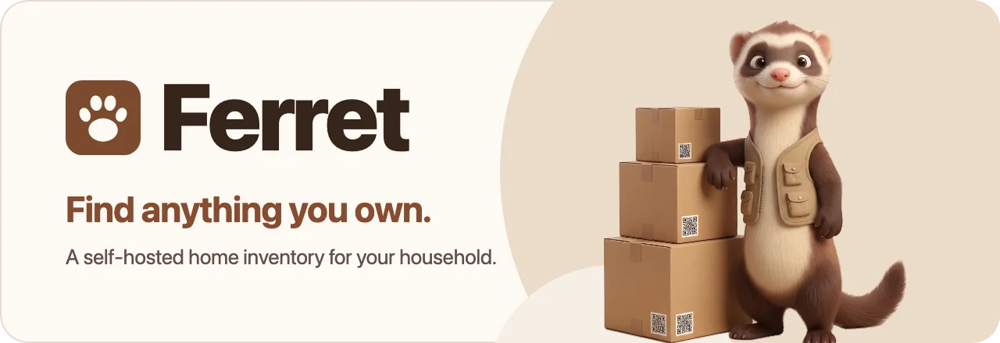
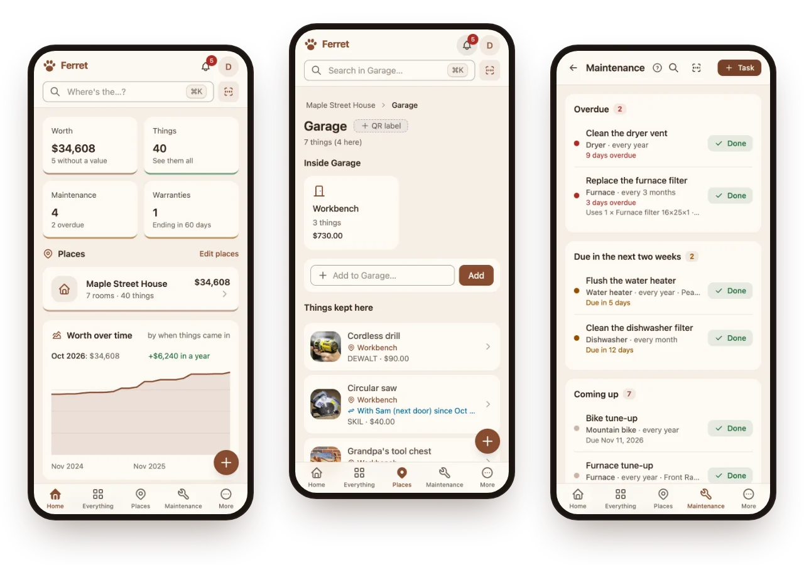
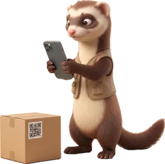

<picture>
  <source media="(prefers-color-scheme: dark)" srcset=".github/readme/banner-dark.webp">
  
</picture>

<p align="center">
  <a href="https://github.com/ferret-project/ferret/releases/latest"></a>
  <a href="LICENSE"></a>
  <a href="https://github.com/ferret-project/ferret/pkgs/container/ferret"></a>
  <a href="https://discord.gg/XSkKyP2pdg"></a>
</p>

<p align="center">
  <a href="https://ferret-demo.digitalempire.us"><b>Try the demo</b></a> ·
  <a href="#run-it-docker"><b>Install</b></a> ·
  <a href="https://ferret-demo.digitalempire.us/docs/"><b>Help</b></a> ·
  <a href="https://discord.gg/XSkKyP2pdg"><b>Discord</b></a>
</p>

**Ferret is a home inventory you run yourself.** Your household's properties, rooms and boxes; the things in them with
photos, receipts and manuals; warranties, maintenance and stock — all on your own server, shared with the people you
live with. And when you need something, Ferret tells you where it is.

<picture>
  <source media="(prefers-color-scheme: dark)" srcset=".github/readme/screens-dark.webp">
  
</picture>

## What it does

<table>
  <tr>
    <td align="center" width="33%">
      <br>
      <b>Add things fast</b><br>
      Snap a photo, scan a barcode, or photograph a whole room and pick what to keep.
    </td>
    <td align="center" width="33%">
      <br>
      <b>Boxes and QR labels</b><br>
      Print labels for boxes and shelves; scan one to see what's inside.
    </td>
    <td align="center" width="33%">
      <br>
      <b>Find anything</b><br>
      Search by name, place or meaning — or just ask, “where's the drill?”
    </td>
  </tr>
  <tr>
    <td align="center">
      <br>
      <b>Receipts and warranties</b><br>
      Keep receipts and manuals with each thing, and hear before a warranty runs out.
    </td>
    <td align="center">
      <br>
      <b>Maintenance</b><br>
      Filters, tune-ups and checks on a schedule, with reminders when they're due.
    </td>
    <td align="center">
      <br>
      <b>Stock and shopping</b><br>
      Track what runs out and keep the shopping list in step.
    </td>
  </tr>
  <tr>
    <td align="center">
      <br>
      <b>Lending</b><br>
      Remember who borrowed the saw, and since when.
    </td>
    <td align="center">
      <br>
      <b>Insurance report</b><br>
      Everything you own and what it's worth, ready for a claim, plus recall checks.
    </td>
    <td align="center">
      <br>
      <b>API and MCP</b><br>
      A REST API for scripts, and an MCP server so Claude can look things up and add them.
    </td>
  </tr>
</table>

## Why Ferret

- **Your server, your data.** One Docker container with SQLite. Uploads are encrypted at rest with a key per
  household; nightly backups with a restore check; *Download everything* any time.
- **Households, not just accounts.** Owners, admins, members and read-only viewers; invitations by email; single
  sign-on through your own identity provider.
- **AI is optional.** Point it at your own models (Ollama, any OpenAI-compatible server, docling) for suggestions from
  photos, receipts read for you, *Ask Ferret* and search by meaning. Nothing is applied without a tap.
- **Made for the phone.** An installable app that works offline, with barcode and QR scanning built in.

## Run it (Docker)

```bash
curl -O https://raw.githubusercontent.com/ferret-project/ferret/main/compose.yaml
curl -o .env https://raw.githubusercontent.com/ferret-project/ferret/main/.env.example
# In .env: AUTH_SECRET and FILES_KEY (each: openssl rand -base64 32), and PUBLIC_URL
docker compose up -d
```

Then open `PUBLIC_URL`; the first account made is the server admin. Keep a copy of `FILES_KEY` somewhere safe —
without it, uploaded files can't be read. Behind a reverse proxy, set `TRUSTED_PROXIES` to its address.

The help is built in at `/docs`: [installing](https://ferret-demo.digitalempire.us/docs/hosting/install),
[every setting](https://ferret-demo.digitalempire.us/docs/hosting/configuration),
[AI](https://ferret-demo.digitalempire.us/docs/hosting/ai), [backups](https://ferret-demo.digitalempire.us/docs/hosting/backups)
and [connecting Claude](https://ferret-demo.digitalempire.us/docs/guide/claude).

## Develop

Requirements: Node 26+, pnpm 10 (`npm install -g corepack && corepack enable`).

```bash
cp .env.example .env      # AUTH_SECRET and FILES_KEY, as above
pnpm install
pnpm dev                  # server on :8787, web app on :5173
pnpm test
pnpm typecheck
```

| Path | What |
|---|---|
| `apps/server` | Hono API, Better Auth, Drizzle + SQLite; MCP server; adapters behind ports (`src/ports.ts`) |
| `apps/web` | React 19 + Vite + Tailwind v4 + FlyonUI PWA |
| `apps/docs` | The help (VitePress), served at `/docs` |
| `packages/shared` | Zod schemas and helpers shared by the server and the web app |

## License

[MIT](LICENSE). Questions, ideas or something odd? Come say hi on [Discord](https://discord.gg/XSkKyP2pdg).

<p align="center"></p>
